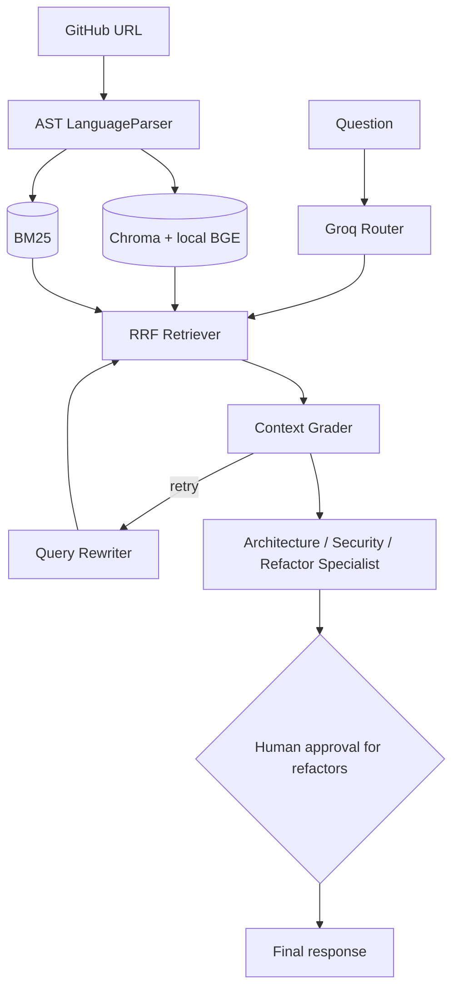

# CodeGraph-Sentinel

Multi-agent AST codebase and architecture reviewer powered by Tree-sitter parsing, local HuggingFace embeddings, BM25/RRF hybrid retrieval, Groq, LangGraph, and Streamlit.

## Architecture



## Quickstart

Use Python 3.11 or 3.12. The `tree-sitter-languages` wheel used by LangChain's
`LanguageParser` is not currently published for Python 3.13 on Windows.

```powershell
cd codegraph-sentinel
python -m venv .venv
.venv\Scripts\Activate.ps1
pip install -r requirements.txt
Copy-Item .env.example .env
streamlit run app.py
```

Add a free `GROQ_API_KEY` from [console.groq.com](https://console.groq.com) to `.env`. The BGE embedding model downloads locally and runs on CPU. No OpenAI API is used.

For Streamlit Community Cloud, add `GROQ_API_KEY` and optional LangSmith values
under the app's Secrets settings. The app reads these server-side and never
renders the API key in the browser.

## Engineering highlights

- AST-aware source chunks preserve functions and classes instead of splitting blindly.
- Dense local BGE retrieval is fused with BM25 lexical symbol matching using reciprocal rank fusion.
- A structured grader and query-rewrite loop improves retrieval before synthesis.
- Refactor proposals pause at a LangGraph `interrupt()` checkpoint until explicitly approved.

## Resume bullets

- Built a multi-agent codebase review platform using LangGraph, Tree-sitter AST parsing, Groq inference, and Streamlit.
- Implemented local BGE plus BM25 reciprocal-rank-fusion retrieval for symbol-aware code search.
- Added stateful human approval gates and node latency telemetry for safe automated refactoring proposals.
